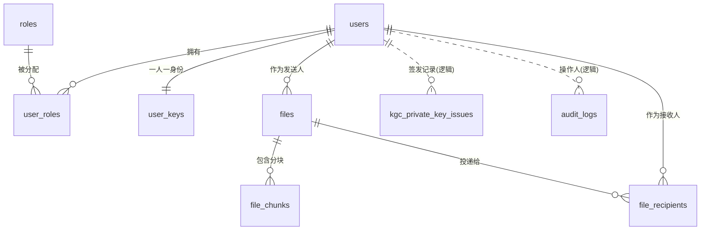

# 02 数据库设计

对应设计文档第五阶段（数据库设计）。脚本：[`database/schema.sql`](../database/schema.sql)、[`database/init_data.sql`](../database/init_data.sql)。

> 已用 H2(MODE=MySQL) 实测：建表、约束、外键、连表查询、UTF-8 中文入库全部通过。schema.sql 写成可移植 SQL，**同一份文件**开发期跑 H2、演示期跑 MySQL 8。

## 1. 表清单（10 张核心表，对应 §18.8 优先表）

| 表名 | 作用 | 主键 |
|---|---|---|
| roles | 角色（RBAC） | id 自增 |
| users | 用户账号（只存 BCrypt 哈希） | id 自增(演示 10001起) |
| user_roles | 用户-角色多对多 | id 自增 |
| user_keys | 用户 SM9 身份标识与密钥状态（**不存私钥**） | id 自增 |
| kgc_private_key_issues | KGC 私钥签发审计 | id UUID |
| files | 文件投递主记录（元数据已加密） | id UUID |
| file_chunks | 文件密文分块（含 SM3 摘要） | id 自增 |
| file_recipients | 接收人与 SM9 密钥信封（多人接收核心） | id 自增 |
| audit_logs | 审计日志（SM3 哈希链字段） | id 自增 |
| login_attempts | 登录失败聚合/限流（替代 Redis） | id 自增 |

MVP 暂缓：departments、security_events、devices、system_config、kgc_master_key_versions、file_download_logs。

## 2. ER 关系图

- 实线（硬外键）：`user_roles`、`user_keys`、`files.sender_id`、`file_chunks.file_id`、`file_recipients.file_id/recipient_id`。
- 虚线（逻辑外键，审计独立留存，不设硬外键）：`kgc_private_key_issues`、`audit_logs`、`login_attempts`。
  - 理由：审计/登录记录需在用户被删后仍可追溯，且 `login_attempts` 可能记录不存在的用户名（失败爆破）。

## 3. 关键约束与索引（对应 §18.8）

| 约束/索引 | 表 | 作用 |
|---|---|---|
| UNIQUE username | users | 账号唯一 |
| UNIQUE user_id | user_keys | 一个用户一条密钥记录 |
| UNIQUE sm9_identity | user_keys | 身份标识唯一 |
| UNIQUE (file_id, chunk_index) | file_chunks | 分块不重复 |
| UNIQUE (file_id, recipient_id) | file_recipients | 同一文件同一接收人唯一 |
| UNIQUE (user_id, role_id) | user_roles | 角色不重复分配 |
| UNIQUE username | login_attempts | 按账号聚合限流 |
| INDEX created_at | audit_logs | 按时间查审计 |
| INDEX sender_id | files | 发件箱查询 |
| INDEX recipient_id | file_recipients | 收件箱查询 |
| CHECK status 枚举 | users/files/file_chunks/file_recipients/user_keys/kgc_issues | 状态值合法性 |

状态枚举（对应 §18.7）：
- `users.status`: ACTIVE / DISABLED / LOCKED
- `user_keys.key_status`: UNINITIALIZED / ISSUED / REISSUED / REVOKED
- `files.status`: INIT / UPLOADING / AVAILABLE / FAILED / DELETED
- `file_chunks.upload_status`: PENDING / UPLOADED / FAILED
- `file_recipients.receive_status`: PENDING / READ；`download_status`: NONE / DOWNLOADED / FAILED

## 4. 敏感数据存储策略（盲存储红线）

数据库**绝不保存**：文件明文、明文文件名、SM4 文件密钥明文、用户 SM9 私钥明文。

| 字段 | 存什么 | 谁能解 |
|---|---|---|
| `files.encrypted_metadata` | SM4 加密后的 {文件名,MIME,备注} JSON | 仅接收人浏览器 |
| `file_recipients.key_envelope` | SM9 按接收人身份封装的 SM4 密钥 JSON | 仅对应接收人的 SM9 私钥 |
| `file_chunks` 对象 | MinIO 中的密文分块 | 仅持 DEK 的接收人 |
| `users.password_hash` | BCrypt 哈希 | 不可逆 |
| `user_keys` | 仅身份标识 + 状态 | 私钥不在服务端 |

## 5. 演示账号（密码统一 `Demo@123`）

| 用户名 | ID | 角色 | SM9 身份标识 |
|---|---|---|---|
| alice | 10001 | EMPLOYEE | user:corp001:10001:alice@example.com |
| bob | 10002 | EMPLOYEE | user:corp001:10002:bob@example.com |
| carol | 10003 | EMPLOYEE | user:corp001:10003:carol@example.com |
| admin | 10004 | SYS_ADMIN | user:corp001:10004:admin@example.com |
| auditor | 10005 | SECURITY_AUDITOR | user:corp001:10005:auditor@example.com |

## 6. 加载注意（UTF-8）

脚本含中文，加载时必须按 UTF-8 读取，否则乱码：
- Spring Boot：`spring.sql.init.encoding=UTF-8`
- MySQL CLI：`mysql --default-character-set=utf8mb4 ... < schema.sql`
- H2：`RUNSCRIPT FROM '.../schema.sql' CHARSET 'UTF-8'`
